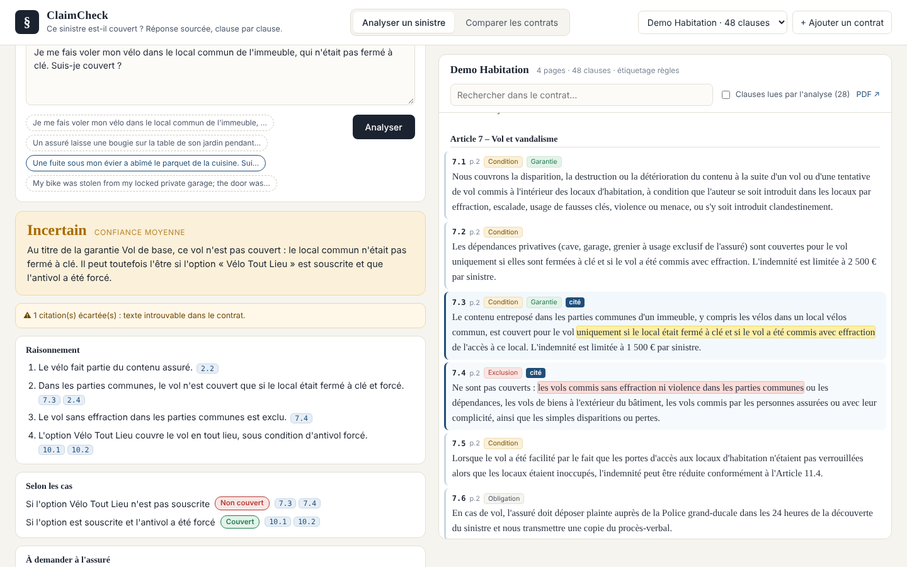

# ClaimCheck : ce sinistre est-il couvert ?

On décrit un sinistre, l'application lit les conditions générales d'assurance habitation et répond **Couvert / Non couvert / Incertain**. Chaque réponse cite les clauses exactes sur lesquelles elle s'appuie, et ces clauses sont surlignées dans le contrat.

L'objectif n'est pas seulement le verdict. Le système doit **montrer ses sources** et **dire quand il ne sait pas** : une option non précisée, un fait manquant ou une clause ambiguë donnent « Incertain », avec les scénarios possibles et les questions à poser à l'assuré.



> Deux contrats sont fournis. « Ethias Habitation » : les conditions générales publiques d'Ethias (Belgique, 36 pages), pour tester le système sur un vrai document. « Démo Habitation » : un contrat **synthétique**, écrit pour la démonstration et l'évaluation, qui ne correspond à aucun assureur. N'importe quel PDF de conditions générales peut être ajouté depuis l'interface.

## Pourquoi pas « le PDF dans un chatbot »

Donner le document brut au modèle fonctionne sur un contrat court, puis se dégrade vite. Les contrats sont longs, les définitions du lexique changent le sens des garanties, et les exclusions générales sont loin des garanties qu'elles limitent. Surtout, rien ne garantit que les citations existent vraiment.

Ici, le contrat est traité comme une **donnée structurée** :

```
PDF ─► clauses (article, sous-article, définition, page)
     ─► étiquettes : type (garantie, exclusion, condition, obligation, définition)
                     péril (vol, incendie, dégâts des eaux…)
                     bien ou lieu (parties communes, jardin, vélo…)
     ─► SQLite : table des clauses + table des étiquettes + index plein texte (FTS5)
```

Une question suit ensuite quatre étapes, toutes visibles dans la « trace technique » de l'interface :

1. **Analyse** : le LLM transforme le récit en faits structurés : périls, biens, faits établis, inconnues, vocabulaire contractuel.
2. **Recherche** : on récupère les clauses par leurs étiquettes (SQL), par recherche plein texte (BM25), plus les définitions du lexique utiles et les dispositions générales. Chaque clause récupérée indique *pourquoi* elle l'a été.
3. **Décision** : le LLM répond **uniquement** à partir de ces clauses, avec des identifiants et des extraits exacts. Il suit un ordre de lecture de gestionnaire : bien assuré → péril garanti → conditions → exclusions → définitions.
4. **Vérification** (déterministe, sans LLM) : chaque extrait cité est recherché dans le texte de la clause en base. Les citations introuvables sont écartées et affichées comme telles. Un verdict ferme sans aucune citation vérifiée est ramené à « Incertain ». Les positions retrouvées servent au surlignage.

## Et pour des centaines de contrats ?

Les clauses de tous les contrats vivent dans la même table, avec leurs étiquettes. L'onglet **« Comparer les contrats »** l'illustre : « quels contrats couvrent le vol dans les parties communes, et à quelles conditions ? » devient une requête SQL. Aucun PDF n'est renvoyé au modèle.

Pour l'analyse d'un sinistre, seul le contrat de l'assuré est interrogé. Son contexte reste petit (28 clauses au plus), quel que soit le nombre de contrats en base.

À grande échelle, les étapes suivantes seraient :

- un étiquetage par LLM, déjà disponible (`--llm` / case à l'ingestion), validé par échantillonnage ;
- un rattachement de chaque contrat à sa version de conditions générales et à ses conditions particulières (options souscrites, plafonds) ;
- un jeu d'évaluation par famille de contrats.

## Évaluation

`eval/cases_demo.json` contient 28 sinistres annotés : verdicts acceptés et clauses clés. Les cas ambigus acceptent « incertain ».

```bash
python eval/run_eval.py --retrieval-only   # sans LLM : rappel de la recherche
python eval/run_eval.py                    # pipeline complet (clé Mistral)
```

Les métriques sont : exactitude du verdict, verdicts fermes à l'opposé de l'attendu (sur-confiance), clauses clés récupérées, clauses clés citées et vérifiées, et part des citations rejetées (signal d'hallucination).

Résultats (`mistral-small-latest`, contrat de démonstration, 28 cas) :

| Métrique | 1er passage | Après ajustement |
|---|---|---|
| Exactitude du verdict | 20/28 (71 %) | **25/28 (89 %)** |
| Verdicts fermes à l'opposé d'un attendu ferme | 0 | **0** |
| Clauses clés récupérées | 100 % | 100 % |
| Clause clé citée et vérifiée | 93 % | 93 % |
| Citations rejetées par la vérification | 14/120 | 8/126 |
| Latence médiane | 5,8 s | 5,5 s |

Au premier passage, les 8 erreurs suivaient un même schéma : « incertain » là où le contrat répond clairement, par excès de prudence (franchise, plafond, faits hypothétiques). Les consignes de décision ont été ajustées : une franchise change le montant, pas la couverture ; la bonne foi du récit est présumée.

Les 3 erreurs restantes :
- *porte non verrouillée* : « non couvert », alors que le contrat laisse une ouverture (introduction clandestine, réduction possible). C'est un verdict ferme sur un cas ambigu, le type d'erreur à surveiller en priorité.
- *réparation de la toiture* et *bijoux volés* : encore « incertain », par prudence sur le plafond ou l'exclusion.

## Lancer en local

Prérequis : Python 3.11+, Node 20+, une clé API Mistral (offre gratuite « Experiment » sur console.mistral.ai).

```bash
cp .env.example .env                 # puis renseigner MISTRAL_API_KEY
pip install -r backend/requirements-dev.txt
cd frontend && npm install && cd ..

make dev-api     # API sur http://localhost:8000
make dev-web     # interface sur http://localhost:5173
make test        # tests (pipeline complet avec un LLM simulé)
```

Pour ajouter un contrat, utilisez le bouton « + Ajouter un contrat », ou :

```bash
cd backend && python -m claimcheck.ingest ../data/contracts/mon_contrat.pdf --name "Assureur X – Habitation"
```

## Déploiement

Le `Dockerfile` construit l'interface React et la sert depuis FastAPI : un seul conteneur, un seul port.

**Hugging Face Spaces (gratuit)** : créez un Space de type *Docker*, poussez ce dépôt, puis ajoutez `MISTRAL_API_KEY` dans *Settings → Secrets*. L'en-tête YAML de ce README configure le Space. La base est reconstruite au démarrage à partir des PDF de `data/contracts/`.

Render, Railway ou Fly.io fonctionnent aussi avec le même Dockerfile.

## Structure

```
backend/claimcheck/
  pdf_parser.py   PDF → clauses (chapitres, articles, sous-articles, lexique ; en-têtes et sommaire ignorés)
  tagging.py      étiquetage par règles (par défaut) ou par LLM
  store.py        SQLite : clauses, étiquettes, FTS5, journal des requêtes
  reasoner.py     analyse → recherche → décision → vérification
  llm.py          client Mistral (mode JSON, reprises sur 429/5xx)
  api.py          FastAPI
frontend/src/     React + TypeScript (Vite)
eval/             jeu de cas annotés + script d'évaluation
scripts/          génération du PDF de démonstration
```

## Limites connues

- Les **conditions particulières** (options souscrites, plafonds) ne sont pas fournies. Le système le signale et raisonne par scénarios.
- Le découpage repose sur la numérotation des articles. Un PDF scanné (sans couche texte) demanderait une étape d'OCR.
- L'étiquetage par règles est simple et transparent, mais imparfait. L'étiquetage LLM est plus précis, mais coûte un appel par clause à l'ingestion.
- Ce n'est pas un avis de couverture : l'outil prépare la décision d'un gestionnaire, il ne la remplace pas.
